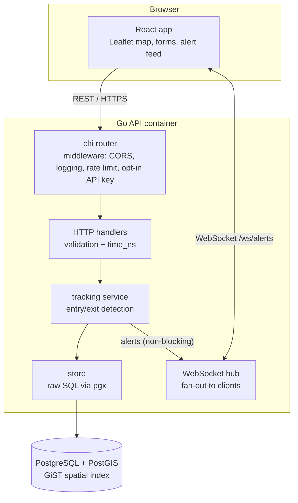
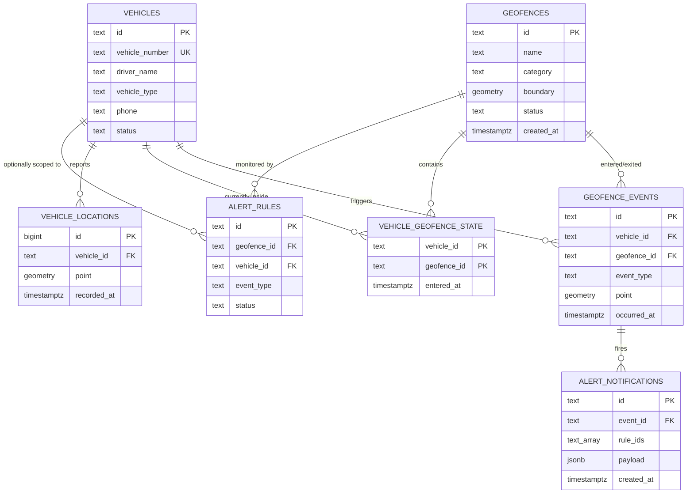

# Architecture — Geofencing & Real-time Alert System

## 1. Overview

A vehicle-tracking platform where operators draw geofences (polygons) on a map, register vehicles, stream location updates, and receive **real-time alerts** when vehicles enter or exit zones (especially `restricted_zone`).

Three deployable pieces:

| Piece | Tech | Hosted on |
|---|---|---|
| Frontend | React + TypeScript (Vite) | Vercel |
| Backend API + real-time | Go (chi, pgx, gorilla/websocket) | Docker container (Render or similar) |
| Database | PostgreSQL 16 + PostGIS 3 | Managed Postgres with PostGIS (Neon / Supabase), `postgis/postgis` locally |

## 2. System diagram



## 3. Technology decisions

| Area | Choice | Why | Alternatives considered |
|---|---|---|---|
| HTTP router | `go-chi/chi v5` | Pure `net/http` handlers (idiomatic Go), composable middleware, path params | Gin (own context type, less idiomatic); Go 1.22 `ServeMux` (fine, but no middleware ecosystem) |
| DB driver | `jackc/pgx v5` + `pgxpool` | Fastest Postgres driver, native types, connection pooling, transactions | GORM (fights PostGIS types, hides SQL we want to show) |
| Geospatial | PostGIS `geometry(Polygon, 4326)` + `ST_Covers` | Point-in-polygon in the DB, accelerated by a GiST index; battle-tested | Go ray-casting (needs to scan every fence each update; we keep one as a tested fallback utility for validation only) |
| Real-time | WebSocket via `gorilla/websocket`, hub pattern | Recommended by spec, bi-directional, mature library | SSE (simpler, one-way), polling (laggy, wasteful) |
| Rate limiting | `go-chi/httprate` | Drop-in chi middleware, per-IP sliding window | Hand-rolled token bucket |
| Migrations | Embedded SQL files (`embed.FS`), applied at startup in order | Zero extra tooling, works the same locally and in cloud | golang-migrate (extra binary) |
| Logging | `log/slog` (stdlib) | Structured JSON logs, no dependency | zap, zerolog |
| Frontend | Vite + React 19 + TypeScript | Fast dev server, typed API contracts | Next.js (SSR not needed for a dashboard) |
| Map | `react-leaflet` + OpenStreetMap tiles + Geoman (draw) | Free, no API key or billing, `[lat, lng]` order matches the API | Mapbox / Google Maps (API keys + billing) |
| Server state | TanStack Query | Built-in loading/error states, caching, invalidation on alerts | Redux / hand-rolled `useEffect` fetching |
| Styling | Tailwind CSS | Fast, consistent design tokens | MUI (heavier, generic look) |
| Toasts | `sonner` | Small, accessible, stackable | react-hot-toast |
| Containers | Multi-stage Dockerfile, docker-compose | Small final image; one command local setup | — |

## 4. Data model



Key idea: **`vehicle_geofence_state` is the source of truth for "where is each vehicle right now"**. Entry/exit detection is a set difference between the old state and the fences covering the new point.

Naming note: the API calls rules "alerts" (`alert_id`). Internally we separate **rules** (`alert_rules`) from **fired alerts** (`alert_notifications`) to avoid ambiguity.

## 5. Core flow — `POST /vehicles/location`

```mermaid
sequenceDiagram
    participant C as Client
    participant H as Handler
    participant DB as Postgres/PostGIS
    participant Hub as WS Hub
    participant UI as Connected browsers

    C->>H: POST /vehicles/location
    H->>H: validate lat/lng/timestamp
    H->>DB: BEGIN; SELECT vehicle FOR UPDATE
    H->>DB: INSERT vehicle_locations
    alt timestamp is newer than last processed
        H->>DB: SELECT fences WHERE ST_Covers(boundary, point)
        H->>DB: SELECT previous state
        H->>H: entries = new − old, exits = old − new
        H->>DB: upsert/delete state, INSERT geofence_events
        H->>DB: match alert_rules, INSERT alert_notifications
    else out-of-order (older) ping
        H->>H: store history only, state unchanged
    end
    H->>DB: COMMIT
    H-)Hub: enqueue alerts (non-blocking)
    H-->>C: 200 current_geofences + time_ns
    Hub-)UI: JSON alert per client
```

Why this shape:
- **Row lock (`FOR UPDATE`) on the vehicle** serialises concurrent pings for the same vehicle, so we never double-fire an entry. Different vehicles don't block each other.
- **Alerts are published after COMMIT** — clients never see an alert for data that was rolled back.
- **Hub enqueue is non-blocking** (buffered channel + `select default`), so a slow browser can never slow the HTTP response.

## 6. Real-time delivery

- Endpoint: `GET /ws/alerts` (upgrade to WebSocket).
- **Hub** goroutine owns the client set; communicates via `register`, `unregister`, `broadcast` channels — no mutex juggling.
- Each **client** has a buffered `send` channel plus `readPump` / `writePump` goroutines.
- Server sends **ping every 30s**; client must pong within 60s, otherwise it is dropped.
- **Slow clients** whose buffer is full are disconnected (they reconnect and re-sync via REST) instead of blocking everyone.
- Frontend reconnects with **exponential backoff + jitter** (1s → 30s cap).
- Every alert is also persisted (`alert_notifications`), so history survives restarts and missed messages.

## 7. Edge cases handled

| Case | Handling |
|---|---|
| `[lat, lng]` input vs PostGIS `(lng, lat)` | Swap once at the store boundary, in both directions; unit-tested |
| Point exactly on a polygon edge or vertex | `ST_Covers` (counts boundary as inside). The spec's own sample point is a vertex and expects `inside`; `ST_Contains` would return false |
| Unclosed polygon / < 4 points / out-of-range coords | 400 with a precise message |
| Self-intersecting ("bow-tie") polygon | Rejected with `ST_IsValid` → 400 |
| Latitude/longitude of `0` | Decoded into pointers so `0` is valid and "missing" is detected |
| Out-of-order location timestamps | Stored in history; do not change inside/outside state |
| Unknown vehicle on location update | 404 |
| Duplicate vehicle number | 409 |
| Duplicate alert rule | 409 |
| Vehicle with no location yet | 200 with `current_location: null`, empty geofences |
| Overlapping geofences | Vehicle can be inside many fences; each tracked independently |
| WebSocket client dies silently | Ping/pong timeout cleans it up |

## 8. Performance & indexing

- `GIST (boundary)` on geofences → point-in-polygon only checks candidate fences via bounding-box index.
- `(vehicle_id, recorded_at DESC)` on locations → fast "latest location" lookups.
- `(vehicle_id, occurred_at DESC)`, `(geofence_id, occurred_at DESC)`, `(occurred_at DESC)` on events → filtered history.
- Partial unique index on alert rules; index on `(geofence_id)` for rule matching.
- `pgxpool` connection pooling; one transaction per location update (single round-trip group).

## 9. Security

- CORS allow-list from `CORS_ORIGINS` env; WebSocket `CheckOrigin` uses the same list.
- Rate limit on `POST /vehicles/location` (per IP, configurable).
- **Optional** API-key middleware (`API_KEY` env). Disabled by default so automated endpoint checks are not blocked.
- Parameterised SQL everywhere (no string-built queries).
- Request body size limit (1 MB).

## 10. Deployment topology

```
Vercel (static React build)  ──HTTPS / WSS──▶  Docker container (Go API)  ──TLS──▶  Managed Postgres + PostGIS
```

- Frontend env: `VITE_API_URL` (WebSocket URL derived: `https → wss`).
- Backend env: `DATABASE_URL`, `PORT`, `CORS_ORIGINS`, `API_KEY` (optional), `LOCATION_RATE_LIMIT`.
- Image pushed to Docker Hub; the host pulls it (or builds from the repo).
- Free tiers usually sleep after inactivity → the UI shows a "waking up the server" state on slow first requests.

## 11. Scaling roadmap (for the video)

To go from a demo to thousands of vehicles and geofences:

1. **Multiple API instances** → the in-memory hub only reaches its own clients. Add a pub/sub layer (Postgres `LISTEN/NOTIFY` first, then Redis or NATS) so every instance broadcasts every alert.
2. **Ingest decoupling** → put location pings on a queue (Kafka / NATS JetStream); workers process them partitioned by `vehicle_id` (keeps per-vehicle ordering without DB row locks).
3. **In-memory spatial index** → cache geofences in an R-tree per worker, invalidated on geofence change; DB stays the source of truth.
4. **Time-series storage** → partition `vehicle_locations` by day (or TimescaleDB) with retention policies.
5. **Read replicas** for history / dashboards.
6. **Auth & multi-tenancy** → JWT, per-org data isolation.
7. **Observability** → Prometheus metrics (update latency, alerts/sec, WS clients), tracing.

## 12. Known limitations (be upfront in the video)

- Single-instance hub (see roadmap #1).
- Geofence edit/delete not in the spec; only create + list (status field allows soft-disable later).
- No user accounts; API key is optional and shared.
- Planar geometry (SRID 4326) — fine for city-scale zones, not for polygons spanning huge areas or the antimeridian (would use `geography`).
