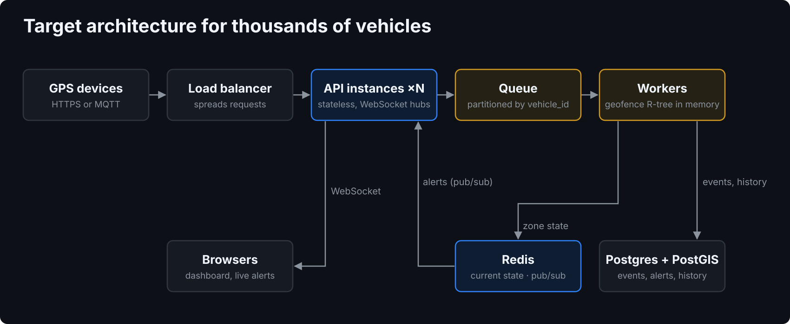

# Gaps, Improvements & Roadmap

Everything in the assessment spec is implemented, including the four bonus items. This page lists what is **not** handled yet, what I would refactor, what production would need, and how the system would scale.

## What's complete

- All 9 endpoints with the exact paths, `time_ns` on every response (errors included)
- PostGIS point-in-polygon (`ST_Covers`) on a GiST-indexed polygon column
- Entry/exit detection in one transaction, with a row lock per vehicle
- Real-time alerts over WebSocket (`/ws/alerts`), stored in `alert_notifications`
- All six frontend features: live map with drawing, vehicles, location updates, alert rules, live alerts, history
- Docker Compose stack, image on Docker Hub, deployed on Render (API) + Vercel (dashboard)
- Bonus: rate limiting, optional API-key auth, pagination, unit + PostGIS integration tests in CI

## Gaps and edge cases not handled yet

| Gap | Why it matters | Fix | Estimate |
| --- | --- | --- | --- |
| Alerts only reach clients connected to the same server instance | With two instances, half the browsers miss alerts | Fan out via Postgres `LISTEN/NOTIFY`, later Redis or NATS | 0.5 day |
| Alerts sent while a browser was offline aren't replayed | They're saved in `alert_notifications`, but no endpoint returns them | `GET` endpoint with a `since` cursor, called on reconnect | 0.5 day |
| GPS jitter on a boundary can fire entry, exit, entry within seconds | Alert spam | Dwell time: count an entry only after ~30 s inside | 1 day |
| Timestamps far in the future are accepted | A device with a wrong clock makes its later updates "stale" | Reject timestamps more than ~5 min ahead of server time | 1 hour |
| Rate limit is per IP, in memory, and trusts `X-Forwarded-For`; its 429 reports `time_ns` "0" | Spoofable, and each instance counts separately | Limit per API key or device in Redis; time the 429 like other responses | 0.5 day |
| Auth is one optional shared API key | No users, roles or audit trail; the WebSocket key travels in the URL | JWT with roles, short-lived WebSocket tickets | 1–2 days |
| No geofence edit or delete (not in the spec) | A hard delete would also erase that zone's history | Soft delete via the existing `status` column, versioned boundaries | 0.5–1 day |
| Polygons: outer ring only, flat SRID 4326 | No holes or multi-part zones; wrong for zones crossing 180° | Accept holes and MultiPolygons; `geography` for very large zones | 1 day |
| Map loads one request per vehicle and moves markers only when an alert fires | Fine for dozens of vehicles, not thousands | Bulk locations endpoint, positions over WebSocket, marker clustering | 1 day |
| No browser end-to-end tests; ~850 KB JavaScript bundle | UI regressions can slip through; slower first load | Playwright tests in CI; lazy-load the map code | 1 day |
| Free hosting tier sleeps (~1 min to wake) | Slow first request | Paid instance or a scheduled keep-alive | Config only |

## What I'd refactor with more time

1. **Cursor pagination for history.** `OFFSET` + `COUNT(*)` get slow with millions of rows; page on `(occurred_at, id)` instead.
2. **Fewer round trips per location update.** It makes about eight queries inside its transaction; send them as one `pgx.Batch` or a single SQL statement.
3. **Generated code.** Store layer with `sqlc`, frontend types from an OpenAPI spec, instead of keeping both in sync by hand.

## Making it production-ready

- **Observability:** logs are already structured JSON with request ids; add Prometheus metrics (update latency, alerts/s, WebSocket clients, DB pool) and tracing.
- **Data:** backups with point-in-time restore, daily partitions for `vehicle_locations` with retention, versioned up/down migrations.
- **Security:** real auth and per-customer isolation, CORS locked to the dashboard's domain, `govulncheck` and `npm audit` in CI.
- **Reliability:** idempotency keys on location updates so device retries aren't double-counted; several API instances behind a load balancer.
- **Devices:** an MQTT bridge, since real GPS trackers often speak MQTT.

## Scaling to thousands of vehicles and geofences

10,000 vehicles sending one ping every 5 seconds is **2,000 updates/s**. Today each update is one transaction of about eight queries, so roughly **16,000 queries/s** on one database — that is the bottleneck to remove.

1. **Stateless API instances** behind a load balancer; alerts fan out through Redis pub/sub or NATS so every instance's browsers get every alert.
2. **Ingest queue** (Kafka or NATS JetStream) partitioned by `vehicle_id`: each vehicle's updates stay in order without row locks, workers scale out, bursts are absorbed.
3. **Geofences cached in memory** in each worker as an R-tree, reloaded when a zone changes; point-in-polygon then needs no database call.
4. **Current state in Redis**; Postgres is written only when something changes (events and alerts), plus location history in batched inserts.
5. **History storage** in time-partitioned tables or TimescaleDB with retention, read from a replica with cursor pagination.
6. **Large, detailed polygons** split with `ST_Subdivide` so each exact test stays cheap.
7. **Frontend at scale:** load only vehicles in the visible map area, cluster markers, subscribe to alerts per customer or region.

## Next two days

Alert replay on reconnect · multi-instance fan-out with `LISTEN/NOTIFY` · dwell-time filtering for GPS jitter · JWT auth.
